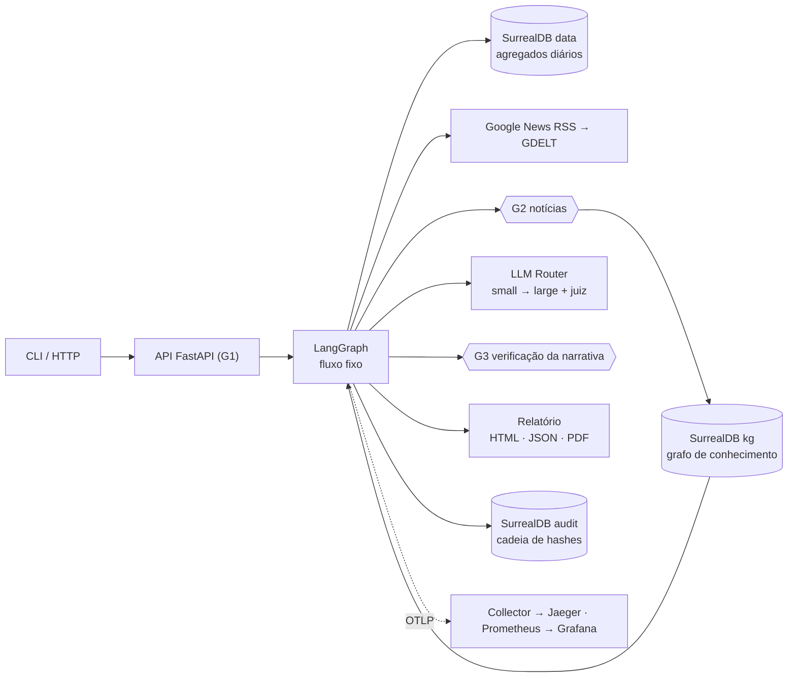

# SRAG Sentinel

Sistema agêntico que gera um **relatório de Síndrome Respiratória Aguda Grave (SRAG)** combinando métricas do OpenDATASUS com notícias em tempo real e um texto escrito por LLM **verificado por código**. PoC de um exercício para a **HealthCare Co., uma empresa fictícia** (nome inventado; qualquer semelhança com empresas reais é coincidência). Os dados de saúde são reais e públicos (OpenDATASUS); a empresa, o contexto de negócio e os "ganhos" discutidos em [`docs/impact.md`](docs/impact.md) são ilustrativos.

O relatório traz 4 métricas (aumento de casos, mortalidade, uso de UTI e vacinação) e 2 gráficos (casos diários nos últimos 30 dias e mensais nos últimos 12 meses), em **HTML, JSON e PDF**, com trilha de auditoria verificável.

> **Estado honesto do projeto:** tudo roda e é testado com modelos simulados e contra um SurrealDB real. **Nenhum LLM real foi exercitado** (sem chave neste ambiente): a qualidade da narrativa, o juiz e a extração de afirmações estão sem medida. Veja [Limitações](#limitações-e-model-card) e [`docs/evaluation.md`](docs/evaluation.md).

## Documentação

| Documento | Para quê |
|---|---|
| [`docs/usage-guide.md`](docs/usage-guide.md) | guia de uso com exemplos (CLI, API, provedores, auditoria) |
| [`docs/architecture-overview.md`](docs/architecture-overview.md) | cada componente, onde está no código e os ADRs/specs/testes correspondentes |
| [`docs/architecture/architecture.pdf`](docs/architecture/architecture.pdf) | diagramas conceituais (PDF entregável) |
| [`docs/adr/`](docs/adr/) | decisões de arquitetura (ADRs 0001–0019) |
| [`docs/surrealdb.md`](docs/surrealdb.md) | guia do SurrealDB: databases e namespaces, recursos, segurança, armadilhas e material de estudo |
| [`docs/impact.md`](docs/impact.md) | impacto da solução e **como foi medido** (com a revisão crítica da medição) |
| [`docs/evaluation.md`](docs/evaluation.md) · [`docs/provider-conformance.md`](docs/provider-conformance.md) | o que foi medido ou não; estado dos provedores de LLM |
| [`SPEC.md`](SPEC.md) · [`docs/specs/`](docs/specs/) | especificações |

## Sumário
[Arquitetura](#arquitetura) · [Quickstart](#quickstart) · [Métricas](#métricas-e-por-que-algumas-são-proxies) · [Agente](#como-o-agente-trabalha) · [GraphRAG e KG](#graphrag-e-grafo-de-conhecimento) · [Router e juiz](#llm-router-e-llm-judge) · [Guardrails](#guardrails) · [Dados pessoais](#dados-pessoais-e-lgpd) · [Governança](#governança-e-auditoria) · [Observabilidade](#observabilidade) · [API](#api-e-cli) · [Desenvolvimento](#desenvolvimento) · [Produção](#caminho-para-produção) · [Limitações](#limitações-e-model-card)

## Arquitetura

Diagrama conceitual em PDF (entregável): [`docs/architecture/architecture.pdf`](docs/architecture/architecture.pdf) — 6 diagramas gerados de [`docs/architecture/architecture.md`](docs/architecture/architecture.md).



Decisões e justificativas: [`docs/adr/`](docs/adr/) (ADRs 0001–0019). Especificações: [`SPEC.md`](SPEC.md) e [`docs/specs/`](docs/specs/).

**Diferenças entre o desenho e a implementação:** os relatórios são guardados como arquivos (volume `reports`, uma pasta por `run_id`) e não no banco `app`, que está reservado; o cache de notícias é em memória.

## Quickstart

Requisitos: Docker (Compose v2). Sem LLM real o sistema funciona, mas o texto sai omitido (relatório *degradado*, só métricas e gráficos).

```bash
cp env.example .env          # preencha as senhas e as chaves/modelos dos provedores que você usa
docker compose --profile jobs run --rm init      # bancos, esquema e usuários por papel
docker compose --profile jobs run --rm ingest    # baixa e agrega o OpenDATASUS (~585 mil linhas)
docker compose up -d --build                     # SurrealDB, API e telemetria
docker compose run --rm --no-deps app report --uf BR
```

O último comando imprime os caminhos de `report.html`, `report.json` e `report.pdf` (dentro do volume `reports`). Para copiá-los: `docker compose cp app:/data/reports ./reports`. Ou use a API: `POST http://127.0.0.1:8080/v1/reports` com `{"uf": "SP"}`.

Interfaces locais (somente `127.0.0.1`): API `:8080`, Jaeger `:16686`, Grafana `:3000` (usuário `admin`, senha `GRAFANA_ADMIN_PASSWORD`). O SurrealDB **não** publica porta.

Teste de ponta a ponta automatizado: `scripts/e2e.sh`.

## Métricas e por que algumas são proxies

Fonte: [OpenDATASUS SRAG](https://opendatasus.saude.gov.br/), contadores diários por UF (janela padrão de 30 dias; escopo Brasil, com filtro opcional por UF).

| Id | Métrica | Definição | Natureza |
|---|---|---|---|
| M1 | Taxa de aumento de casos | (casos janela atual − anterior) / anterior | direta |
| M2 | Taxa de mortalidade | óbitos / desfechos conhecidos entre hospitalizados | direta |
| M3 | Uso de UTI | internados que usaram UTI / internados com informação de UTI | **proxy** (não é ocupação de leitos) |
| M4 | Vacinação entre os casos | casos vacinados / casos com informação, para COVID-19 e para influenza | **proxy** (não é cobertura da população) |

Cada métrica traz numerador, denominador e **completude** (quanto dos registros tem o campo preenchido). Sem denominador, o valor é `n/d`, nunca zero. O eixo é a data de notificação ([ADR 0011](docs/adr/0011-notification-date-and-proxy-metrics.md)) e os 3 dias mais recentes são deixados de fora por padrão (`settle_days`, [ADR 0015](docs/adr/0015-settle-days-and-partial-ingest-guard.md)) porque a notificação atrasa e geraria uma falsa queda. No dado real isso mudou M1 de −15,6% para −8,8%.

## Como o agente trabalha

Fluxo **fixo** em LangGraph ([ADR 0001](docs/adr/0001-langgraph-fixed-flow.md)), sem ferramentas para os modelos ([ADR 0004](docs/adr/0004-llms-without-tools-untrusted-data.md)):

`valida a requisição (G1) → busca métricas e séries → planeja buscas (modelo pequeno) → coleta notícias → filtra (G2) → constrói o grafo → recupera contexto → sintetiza (modelo grande) → verifica (G3) ⇄ sintetiza, uma vez → renderiza → finaliza`

Os **números do texto só podem vir das métricas calculadas por código**. Se a narrativa não passa no G3 depois de uma segunda tentativa, o relatório sai **sem texto**, só com métricas e gráficos, e avisa o motivo. As degradações possíveis são `PLAN_FALLBACK`, `NEWS_UNAVAILABLE`, `KG_UNAVAILABLE`, `NARRATIVE_REJECTED` e `PDF_UNAVAILABLE`.

## GraphRAG e grafo de conhecimento

O SurrealDB também hospeda um **grafo de conhecimento** (banco `kg`, [ADR 0016](docs/adr/0016-graphrag-on-surrealdb.md) e [0017](docs/adr/0017-knowledge-graph-model.md)): UFs, regiões (com fronteiras), patógenos, artigos, **afirmações** extraídas das notícias, snapshots das métricas e relatórios.

- **Construção:** entidades por dicionário (sem LLM); afirmações por modelo pequeno com saída em esquema fechado. Só entra no grafo o que passou em validadores determinísticos (trecho literal do texto, entidades da ontologia, sem instruções) e, quando a política pede, no juiz. O resto vai para quarentena. Tudo carrega proveniência (quem extraiu, quem julgou) e expira em 30 dias.
- **Recuperação:** busca textual BM25 em pt-BR + expansão por vizinhança no grafo (até 2 saltos) + resumo regional verificado, ranqueados por relevância, confiança, recência e proximidade. Cada evidência chega ao LLM com `evidence_id`, e o relatório mostra o **caminho no grafo** e a proveniência das que foram citadas.
- Esquema, buscas e achados do banco: [ADR 0019](docs/adr/0019-surrealdb-kg-findings.md). Vetores (HNSW) ficaram fora desta entrega.

## LLM Router e LLM Judge

Tarefas estreitas rodam num modelo **pequeno** e só sobem para o **grande** se não passarem na verificação ([ADR 0018](docs/adr/0018-llm-router-and-judge.md)): política estática em `llm/router/policy.yaml` (tarefa → camadas), validadores antes do juiz, juiz por rubrica versionada que **nunca desfaz um erro de validador**, e `report.synthesize` sempre no modelo grande. Sem camada `small` configurada, tudo roda no grande.

**Provedores e prioridade.** Suportados: OpenRouter, Groq, NVIDIA NIM, Unsloth (e qualquer servidor compatível com a API da OpenAI: vLLM, llama.cpp), Gemini, Ollama e Anthropic ([ADR 0007](docs/adr/0007-llm-port-and-providers.md)). A camada `large` aceita uma **lista de prioridade com failover**: o primeiro provedor utilizável atende e, se falhar (indisponível, limite de taxa, resposta inválida), o próximo é tentado. Provedores sem chave, endpoint ou pacote são ignorados. Ordem padrão sugerida: OpenRouter → Groq → NVIDIA NIM → Unsloth → Gemini → Ollama.

```bash
SRAG_LLM_PRIORITY="openrouter=<modelo>,groq=<modelo>,nvidia=<modelo>,unsloth=<modelo>,google_genai=<modelo>,ollama=<modelo>"
GROQ_API_KEY=... OPENROUTER_API_KEY=...        # só as chaves dos provedores que você usa
SRAG_UNSLOTH_BASE_URL=http://localhost:8888/v1  # o endpoint é obrigatório; a chave, opcional
SRAG_OLLAMA_BASE_URL=http://localhost:11434     # padrão; use host.docker.internal dentro do Docker
```

Nenhum id de modelo é fixado em código: informe os que você tem acesso. Se um servidor não aceitar o modo padrão de saída estruturada, ajuste com `SRAG_LLM_STRUCTURED_METHOD` (`function_calling`, `json_schema` ou `json_mode`). Veja [`docs/provider-conformance.md`](docs/provider-conformance.md).

## Guardrails

| Camada | Onde | O que faz |
|---|---|---|
| G1 | entrada | esquema estrito (UF, datas, janela 7–90), erros que **não repetem a entrada** |
| G2 | notícias | remove caracteres ocultos, detecta instruções (PT/EN), confiança da fonte por domínio, relevância, datas, PII; entrega ao modelo **escapado e delimitado** |
| G3 | saída | números só das métricas (ou da notícia citada, com atribuição), referências existentes, cobertura M1–M4, proxies declarados, sem links, conselho clínico ou tom alarmista; **falha fecha** |
| G4 | orçamento | teto de chamadas por camada, consultas, artigos e prazo por relatório |

Teste adversarial em [`tests/guardrails/`](tests/guardrails/) (35 payloads de injeção, parâmetros hostis, envenenamento do KG, manipulação do juiz).

## Dados pessoais e LGPD

- Só **7 colunas** do dado aberto são lidas e só **contadores diários por UF** são gravados: nenhuma linha de paciente chega ao banco, aos logs, à telemetria ou a um modelo ([ADR 0002](docs/adr/0002-datasus-column-allowlist-and-aggregates.md)).
- Notícias passam por um removedor de PII (CPF/CNPJ com dígito verificador, e-mail, telefones) antes de qualquer uso; o grafo não tem nós de pessoa.
- Segredos só por variável de ambiente (`SecretStr`), nunca em imagem ou log. O arquivo `.env` é ignorado pelo git; `env.example` é o modelo.
- Os usuários de banco têm o mínimo de privilégio: a API lê com um usuário só de leitura; a auditoria é escrita por um usuário que não consegue alterar nem apagar.

## Governança e auditoria

Toda execução grava eventos numa **cadeia de hashes** (banco `audit`): cada evento tem `seq`, `prev_hash` e `hash`; conteúdo entra só como hash ([ADR 0005](docs/adr/0005-hash-chained-audit.md)). Um erro de escrita aborta a execução.

```bash
docker compose run --rm --no-deps app audit verify                       # recalcula a cadeia
docker compose run --rm --no-deps app audit export --out /tmp/audit.jsonl
docker compose run --rm --no-deps app audit verify --expected-head <hash> # detecta truncamento do fim
```

Guarde o `head` exportado **fora do banco**: alterações no meio da cadeia são sempre detectadas, mas apagar o fim só com essa âncora. A API expõe `GET /v1/audit/{run_id}`.

## Observabilidade

OpenTelemetry com traces (`report.run` e um span por nó), métricas `srag.*` e logs JSON com `trace_id`, via Collector para Jaeger, Prometheus e Grafana (dashboard e alertas de exemplo provisionados em [`observability/`](observability/)). Os atributos vêm dos eventos de auditoria e **nunca carregam conteúdo** ([ADR 0010](docs/adr/0010-telemetry-from-audit-events.md)). Ainda não há métricas de tokens e custo por chamada.

## API e CLI

| Rota | Função |
|---|---|
| `POST /v1/reports` | gera um relatório (corpo: `uf`, `as_of`, `window_days`) |
| `GET /v1/reports/{run_id}?format=json\|html\|pdf` | devolve um artefato |
| `GET /v1/audit/{run_id}` | eventos de auditoria da execução |
| `GET /healthz` · `GET /readyz` | vivo · banco acessível e com dados |

Erros no formato RFC 9457 (`application/problem+json`), sem eco da entrada nem detalhes internos. CLI: `srag-sentinel db init | ingest | metrics | report | serve | audit verify | audit export`.

## Desenvolvimento

```bash
uv sync --all-extras
uv run ruff check . && uv run ruff format --check . && uv run mypy
uv run pytest                                   # unitários e guardrails (sem banco nem rede)
SURREAL_ROOT_PASSWORD=<senha> docker compose -f compose.yaml -f compose.dev.yaml up -d surrealdb
SURREAL_ROOT_PASSWORD=<senha> uv run pytest -m "integration or not integration"
GROQ_API_KEY=... SRAG_LLM_PRIORITY="groq=<modelo>" uv run --extra groq pytest -m live   # conformidade com modelo real
```

Python 3.14 ([ADR 0008](docs/adr/0008-python-version.md)). Skills de apoio por tecnologia em [`.claude/skills/`](.claude/skills/). Histórico em [`CHANGELOG.md`](CHANGELOG.md); plano em [`tasks/`](tasks/).

**Solução de problemas.** `readyz` 503: rode `init` e `ingest`. PDF ausente (`PDF_UNAVAILABLE`): faltam as bibliotecas do Pango (a imagem Docker as inclui). Relatório degradado: veja `degradations` no JSON e a chave do provedor. Falha de `init`: confira as senhas em `.env`.

## Caminho para produção

Não implementado, mas previsto: segredos em um gerenciador (não `.env`), TLS e autenticação na API (hoje só em `127.0.0.1`), SurrealDB em cluster com backups e a âncora da auditoria em armazenamento imutável, fila e execução assíncrona para os relatórios (o modo atual é síncrono), cache de notícias compartilhado, limites de taxa, métricas de custo por modelo, e uma rotina periódica de `kg prune`.

## Limitações e model card

- **Narrativa não avaliada com LLM real.** O G3 garante que os números vêm das métricas e que as referências existem; não garante que o texto seja bom, nem que as notícias sejam verdadeiras.
- **UTI e vacinação são proxies.** Não representam ocupação de leitos nem cobertura vacinal; usam só registros com o campo preenchido.
- **Dado em consolidação.** A notificação atrasa; por isso há `settle_days` e avisos de maturidade, e os números recentes podem mudar.
- **Notícias.** Fontes públicas e instáveis; a confiança por domínio é uma lista curta e manual; o relatório lista as fontes mas não verifica os fatos.
- **Grafo.** Entidades por dicionário (cidades não viram UF), afirmações dependem do modelo pequeno, sem vetores; corpus de avaliação pequeno e escrito à mão.
- **Auditoria.** Detecta adulteração, mas apagar o fim da cadeia só é detectável com a âncora externa.
- **Uso pretendido.** Apoio informativo à vigilância; **não** substitui análise epidemiológica nem orienta conduta clínica individual.

Avaliações e o que falta medir: [`docs/evaluation.md`](docs/evaluation.md).
