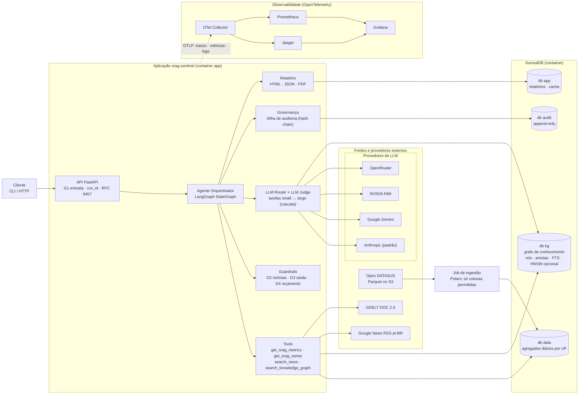
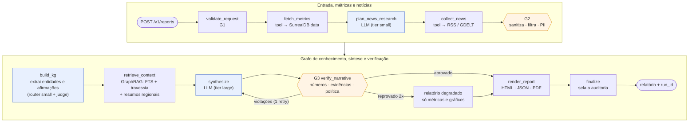
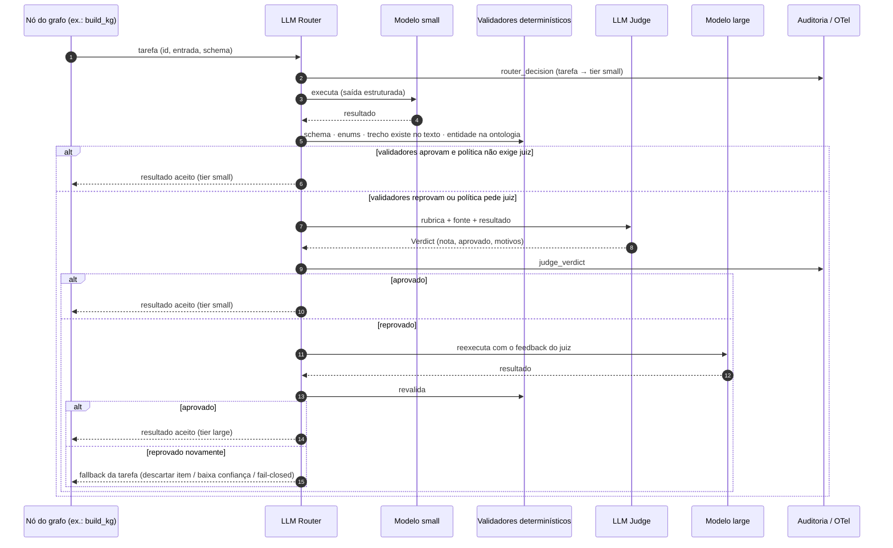
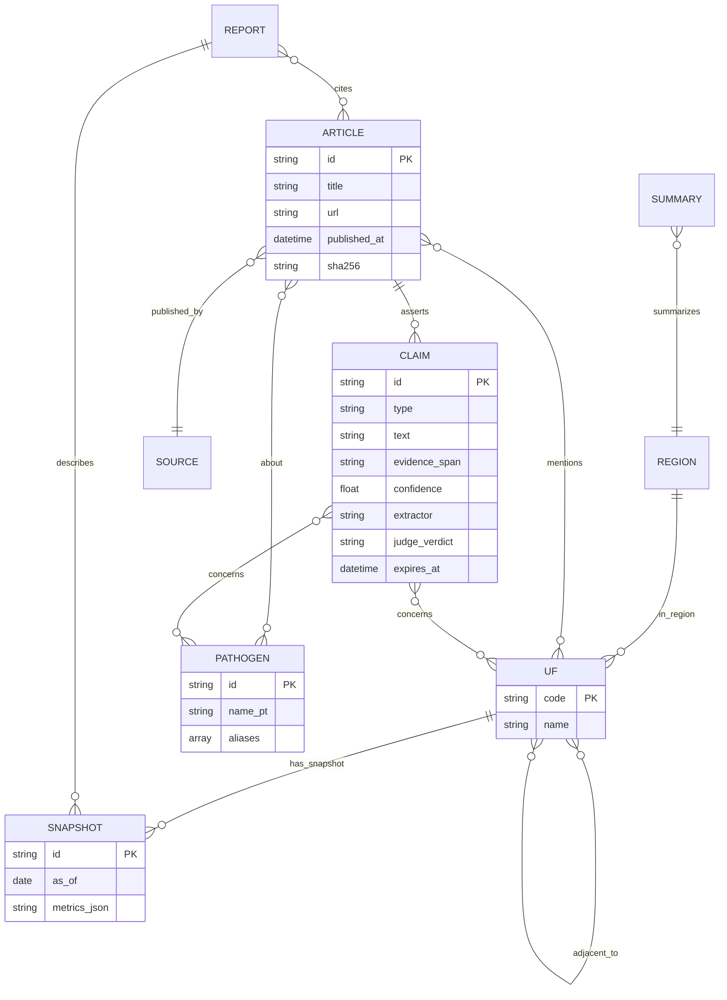
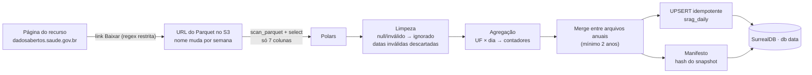
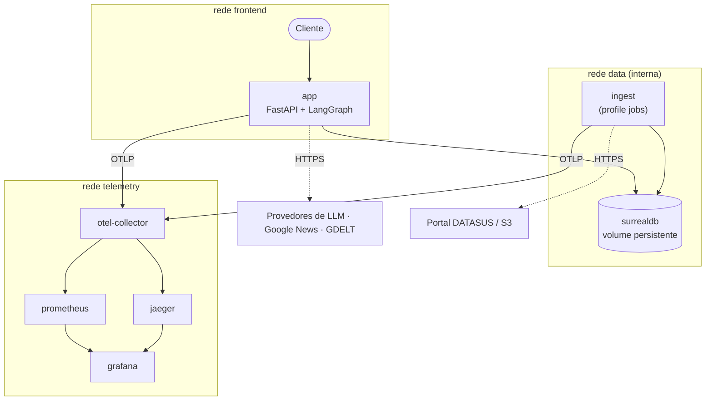

# Arquitetura — SRAG Sentinel (diagramas Mermaid)

> Fonte de verdade dos diagramas (renderizam no GitHub). O PDF entregável (T19) é gerado a partir deste arquivo. Descrição textual em [`docs/specs/01-architecture.md`](../specs/01-architecture.md). Legenda: **G1–G4** = guardrails; **KG** = grafo de conhecimento; **tier small/large** = modelos pequenos/grandes do [LLM Router](../specs/08-llm-router-judge.md).

## 1. Visão geral (contexto e componentes)

## 2. Fluxo do agente (LangGraph) com GraphRAG

## 3. LLM Router e LLM Judge (cascata)

## 4. Modelo do grafo de conhecimento

## 5. Ingestão e dados

## 6. Implantação (Docker Compose)

