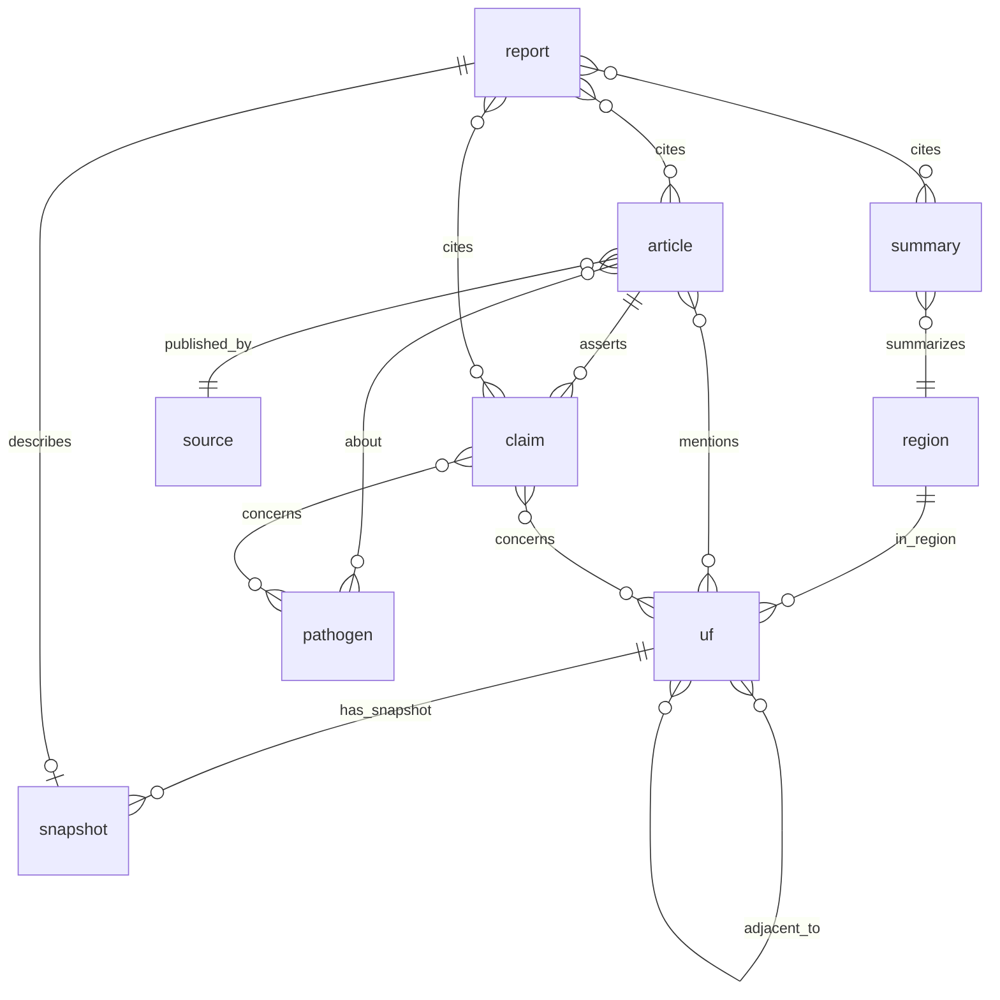
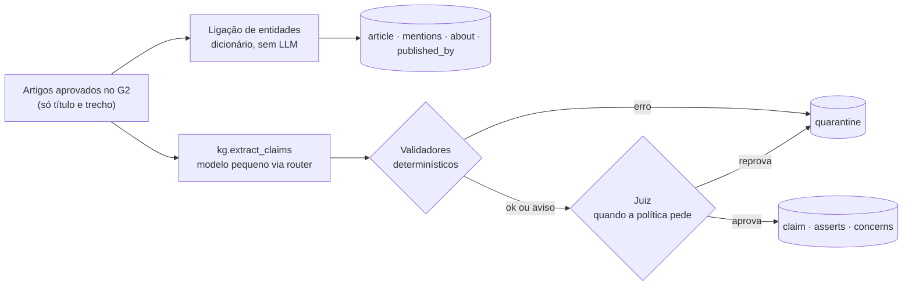

# Ontologia e grafo de conhecimento

Como o SRAG Sentinel modela o que "sabe" (UFs, regiões, patógenos, notícias e afirmações extraídas delas), como constrói esse grafo, como o consulta (GraphRAG) e quais garantias oferece. Decisões: [ADR 0016](adr/0016-graphrag-on-surrealdb.md), [ADR 0017](adr/0017-knowledge-graph-model.md), [ADR 0019](adr/0019-surrealdb-kg-findings.md) · especificação: [spec 07](specs/07-graphrag-knowledge-graph.md) · banco: [guia do SurrealDB](surrealdb.md).

## 1. Para que serve

O grafo guarda **o que as notícias disseram** (afirmações) separado de **o que o sistema mediu** (métricas calculadas por código). Ele permite ao relatório explicar o cenário com **evidências citáveis**, com contexto regional (vizinhança de UFs), por patógeno e com **proveniência** (quem extraiu, quem julgou, de qual artigo e fonte).

Regra de ouro ([ADR 0017](adr/0017-knowledge-graph-model.md)): **números de notícias nunca viram métrica.** Uma afirmação como "30 mortes" fica no grafo como texto atribuído; as métricas M1–M4 só vêm do banco `data`.

## 2. Ontologia (fechada e pequena)

Ontologia **fechada**: os tipos de nó, de aresta e os valores permitidos são fixos em código e no esquema. Nenhum modelo de linguagem cria tipos novos, o que torna o grafo validável e difícil de envenenar.



### Nós

| Nó | Origem | Campos principais |
|---|---|---|
| `region` | semente | `code` (N, NE, CO, SE, S), `name` |
| `uf` | semente | `code` (27 UFs + `BR` para o escopo nacional), `name`, `region` |
| `pathogen` | semente | `id`, `name_pt`, `aliases[]` |
| `source` | derivado do domínio do artigo | `domain`, `trust` (0 a 1, da lista de confiança do G2) |
| `article` | notícia já aprovada no G2 | `title`, `snippet`, `text` (indexado), `url`, `published_at`, `sha256`, `run_id`, `expires_at` |
| `claim` | extraída por modelo pequeno | `type`, `direction`, `text`, `evidence_span`, `confidence`, `produced_by`, `judge`, `run_id`, `expires_at` |
| `snapshot` | código (métricas do relatório) | `scope`, `as_of`, `window_days`, `metrics`, `run_id` |
| `report` | código | `run_id`, `generated_at`, `status` |
| `summary` | modelo pequeno + juiz | `scope` (região), `text`, `evidence_ids[]`, `valid_until` |
| `quarantine` | código | `kind`, `reason`, `article_id`, `run_id` (itens reprovados, fora do grafo) |

### Enums fechados de uma afirmação

- **`type`**: `alert_level`, `case_trend`, `death_trend`, `hospital_pressure`, `vaccination`, `outbreak`, `public_health_measure`, `other`.
- **`direction`**: `up`, `down`, `stable`, `unknown`.

### Arestas (11 tipos, todas com `produced_by`, `created_at` e `run_id`)

| Aresta | De → Para | Observação |
|---|---|---|
| `in_region` | `uf → region` | estática |
| `adjacent_to` | `uf → uf` | estática e **simétrica** (verificada em teste) |
| `published_by` | `article → source` | |
| `mentions` | `article → uf` | entidade ligada por dicionário |
| `about` | `article → pathogen` | idem |
| `asserts` | `article → claim` | |
| `concerns` | `claim → uf \| pathogen` | |
| `has_snapshot` | `uf → snapshot` | memória entre relatórios |
| `describes` | `report → snapshot` | |
| `cites` | `report → article \| claim \| summary` | só o que a narrativa realmente citou |
| `summarizes` | `summary → region` | |

No esquema ([`kg.surql`](../src/srag_sentinel/kg/schema/kg.surql)) as arestas são tabelas `TYPE RELATION ... ENFORCED`: uma relação entre tipos errados é **recusada pelo banco**.

## 3. Sementes versionadas

Em [`kg/seed/`](../src/srag_sentinel/kg/seed), carregadas e **validadas no boot** por [`kg/seeds.py`](../src/srag_sentinel/kg/seeds.py) (uma edição errada falha cedo):

- [`ufs.yaml`](../src/srag_sentinel/kg/seed/ufs.yaml): 27 UFs com nome e região, mais `BR`.
- [`adjacency.yaml`](../src/srag_sentinel/kg/seed/adjacency.yaml): fronteiras terrestres, listadas pelos dois lados de propósito; o teste exige **simetria**, ausência de laços e pelo menos um vizinho por UF.
- [`pathogens.yaml`](../src/srag_sentinel/kg/seed/pathogens.yaml): 10 agentes e seus apelidos em pt-BR, **únicos entre patógenos** (testado).

| Id | Nome | Exemplos de apelidos |
|---|---|---|
| `influenza_a` · `influenza_b` | Influenza A / B | `influenza a`, `h1n1`, `h3n2` · `influenza b` |
| `influenza` | Influenza (gripe) | `influenza`, `gripe`, `síndrome gripal` |
| `sars_cov_2` | SARS-CoV-2 (COVID-19) | `covid-19`, `covid`, `coronavírus` |
| `vsr` | Vírus sincicial respiratório | `vsr`, `bronquiolite` |
| `rinovirus` · `metapneumovirus` · `adenovirus` · `parainfluenza` | agentes respiratórios | o próprio nome (`hmpv` para o metapneumovírus) |
| `srag_nao_especificada` | SRAG não especificada | `srag`, `síndrome respiratória aguda grave` |

`db init` grava as sementes de forma **idempotente** (arestas com ID determinístico, ex.: `adjacent_to:SP_RJ`).

## 4. Construção do grafo (`build_kg`)



1. **Entrada.** Só artigos que já passaram pelo **G2** (sanitizados, sem PII), e apenas título e trecho curto. Nunca o texto integral.
2. **Ligação de entidades** ([`kg/entities.py`](../src/srag_sentinel/kg/entities.py)), determinística. Nomes de UF são casados **com acento** e sem diferenciar maiúsculas (a preposição "para" nunca vira Pará); apelidos de patógenos são casados sem acento; a correspondência é por palavra inteira e a mais longa vence ("Mato Grosso do Sul" ≠ "Mato Grosso"; "parainfluenza" ≠ "influenza"; "InfoGripe" ≠ "gripe"). Cidades não viram UF.
3. **Extração de afirmações** ([`kg/extract.py`](../src/srag_sentinel/kg/extract.py)): modelo pequeno, **sem ferramentas**, saída em esquema fechado (`ClaimDraft`: tipo, paráfrase, trecho literal, UFs, patógenos, direção), no máximo 3 por artigo. O texto do artigo vai **escapado e delimitado** como dado não confiável.
4. **Validadores** ([`kg/validators.py`](../src/srag_sentinel/kg/validators.py)):

   | Validador | Severidade | Regra |
   |---|---|---|
   | `span_in_source` | erro | o `evidence_span` precisa existir **literalmente** no texto |
   | `entities_in_ontology` | erro / aviso | UF ou patógeno fora da ontologia é erro; entidade válida mas ausente no texto é aviso |
   | `no_instructions` | erro | a afirmação não pode soar como instrução a um modelo |
   | `enums`, `max_items` | erro | valores dos enums; no máximo 3 afirmações |

   **Erro** é definitivo: o juiz nunca o desfaz. **Aviso** é o caso ambíguo que o juiz decide ([ADR 0018](adr/0018-llm-router-and-judge.md)).
5. **Cascata.** Se o modelo pequeno falhar, o router escala para o grande com o feedback; esgotadas as camadas, o item vai para **quarentena** (nunca para o grafo).
6. **Escrita** ([`kg/store.py`](../src/srag_sentinel/kg/store.py)): *upserts* idempotentes (ID da afirmação = hash de artigo, tipo, direção, trecho e entidades), com `produced_by` (`tier/modelo/prompt@versão`), `judge` (nota e rubrica) e `run_id`. O texto da afirmação passa pelo removedor de PII antes de gravar.
7. **Confiança** da afirmação = confiança da fonte × (nota do juiz ÷ 5), ou × 0,8 quando nenhum juiz atuou.
8. **Expiração.** Afirmações e artigos expiram em 30 dias (`SRAG_KG_CLAIM_TTL_DAYS`); `srag-sentinel kg prune` remove os expirados com suas arestas.
9. **Ao final do relatório**, gravam-se `snapshot` (métricas do relatório), `report` e as arestas `describes` e `cites`.

## 5. Recuperação (GraphRAG)

[`kg/retrieve.py`](../src/srag_sentinel/kg/retrieve.py) devolve um **`EvidencePack`**: até 12 itens, cada um com `evidence_id` (`E1`, `E2`…), texto, pontuação, **caminho no grafo** (`graph_path`), proveniência e URL.

1. **Perguntas-guia derivadas das métricas, por código** (não por modelo): M1 > +5% → "por que os casos aumentam?"; M1 < −5% → "por que caem?"; M3 ≥ 30% → pressão hospitalar; M2 ≥ 15% → óbitos; M4 < 50% → vacinação.
2. **Busca textual BM25** (analisador pt-BR), **uma consulta por termo** e soma dos escores, com um **léxico** de variantes ([`kg/lexicon.py`](../src/srag_sentinel/kg/lexicon.py)) porque o *stemmer* não unifica `vacina`/`vacinação` nem `internação`/`internações` ([ADR 0019](adr/0019-surrealdb-kg-findings.md)).
3. **Anel de UFs** a partir do escopo: a própria UF (0 saltos), vizinhas e mesma região (1 salto) e vizinhas das vizinhas (2 saltos). Para `BR`, todas as UFs contam como 1 salto.
4. **Expansão no grafo:** afirmações e artigos ligados às UFs do anel.
5. **Resumo regional** verificado (se houver um válido para a região do escopo) entra sempre, com vaga reservada.
6. **Ranqueamento:** `relevância × confiança × recência × proximidade`.

   | Fator | Valor |
   |---|---|
   | relevância | BM25 normalizado (0,3 quando o item veio só da expansão) |
   | confiança | confiança da afirmação ou da fonte |
   | recência | meia-vida de 14 dias, piso de 0,2 |
   | proximidade | 0 saltos 1,0 · 1 salto 0,7 · 2 saltos 0,5 · só por texto 0,6 · só sobre UFs distantes 0,3 |

   **Deduplicação por artigo:** a afirmação (mais específica e com proveniência) substitui o próprio artigo e herda a relevância textual dele.
7. **Uso na síntese:** o pacote entra no prompt como `<untrusted_evidence>` (escapado). A narrativa cita `evidence_refs`; o **G3** rejeita ids que não existam no pacote, e números só valem se vierem das métricas ou do texto da evidência citada, com atribuição.

Todas as consultas são **modelos fixos com variáveis ligadas**: nenhuma string de modelo vira SurrealQL.

## 6. Segurança do grafo

| Risco | Controle |
|---|---|
| Envenenamento por notícia maliciosa | G2 antes de tudo; confiança por fonte; validadores; juiz; quarentena; expiração |
| Injeção na extração | modelo pequeno sem ferramentas; esquema fechado; texto escapado; afirmação com cara de instrução é rejeitada (testado com 35 payloads) |
| Injeção de SurrealQL | consultas fixas e parametrizadas; tabelas e arestas só de listas fechadas |
| Dado pessoal | nenhum nó de pessoa; só título e trecho; removedor de PII antes de gravar |
| Perda de proveniência | `produced_by`, `judge` e `run_id` em todo nó e aresta gerados; eventos `kg_write` e `kg_quarantine` na auditoria |
| Crescimento sem controle | TTL, limite por artigo e `kg prune` |
| Permissões | `kg_writer` (EDITOR) escreve; `api_ro` (VIEWER) só lê |

## 7. Exemplos

```surql
-- vizinhas de SP e a região
SELECT VALUE ->adjacent_to->uf.code FROM uf:SP;
SELECT VALUE ->in_region->region.name FROM uf:SP;

-- afirmações sobre SP e o artigo de origem
SELECT text, type, direction, produced_by, <-asserts<-article.url AS fonte
FROM claim WHERE id IN (SELECT VALUE in FROM concerns WHERE out = uf:SP);

-- o que foi para a quarentena e por quê
SELECT reason, article_id, run_id FROM quarantine ORDER BY created_at DESC LIMIT 20;
```

## 8. Como estender a ontologia

1. **Novo patógeno:** adicione em `pathogens.yaml` (apelidos únicos) e rode `db init`. Atualize a lista de ids em [`kg_extract_claims.md`](../src/srag_sentinel/llm/prompts/kg_extract_claims.md) (nova versão do prompt) e os testes de sementes.
2. **Novo tipo de afirmação:** é uma mudança de **esquema** (enum em `kg.surql`, em [`kg/claims.py`](../src/srag_sentinel/kg/claims.py) e no prompt), não de dados. Reavalie o corpus ([`tests/fixtures/kg/corpus.json`](../tests/fixtures/kg/corpus.json)).
3. **Nova aresta:** declare a tabela `TYPE RELATION` no esquema, inclua-a em `EDGE_TABLES` ([`kg/seeding.py`](../src/srag_sentinel/kg/seeding.py)) e escreva-a por `INSERT RELATION ... ON DUPLICATE KEY UPDATE`.
4. Mudar a ontologia é **migração**: nova versão das sementes e reaplicação idempotente do esquema.

## 9. Limitações

- A ligação de entidades por dicionário não reconhece cidades (ex.: "Campinas" não vira SP) nem siglas isoladas.
- A qualidade das afirmações depende do modelo pequeno e do juiz; **não foi medida com um modelo real** (o F1 de afirmações usa um extrator oráculo). O F1 de entidades (1,00) e o recall@12 (0,98 em 15 perguntas) vêm de um corpus de 30 manchetes escrito à mão ([avaliação](evaluation.md)).
- Sem vetores/embeddings: a recuperação é lexical (BM25 + léxico) e expansão por grafo.
- A confiança por fonte é uma lista curta e manual.
- Sem detecção de comunidades nem reconciliação entre fontes além do dicionário.

## 10. Onde está no código

| Parte | Arquivo |
|---|---|
| Esquema | [`kg/schema/kg.surql`](../src/srag_sentinel/kg/schema/kg.surql) |
| Sementes e validação | [`kg/seeds.py`](../src/srag_sentinel/kg/seeds.py), [`kg/seeding.py`](../src/srag_sentinel/kg/seeding.py) |
| Entidades e afirmações | [`kg/entities.py`](../src/srag_sentinel/kg/entities.py), [`kg/claims.py`](../src/srag_sentinel/kg/claims.py), [`kg/extract.py`](../src/srag_sentinel/kg/extract.py), [`kg/validators.py`](../src/srag_sentinel/kg/validators.py) |
| Construção e armazenamento | [`kg/build.py`](../src/srag_sentinel/kg/build.py), [`kg/store.py`](../src/srag_sentinel/kg/store.py), [`kg/models.py`](../src/srag_sentinel/kg/models.py) |
| Recuperação e resumos | [`kg/retrieve.py`](../src/srag_sentinel/kg/retrieve.py), [`kg/rank.py`](../src/srag_sentinel/kg/rank.py), [`kg/evidence.py`](../src/srag_sentinel/kg/evidence.py), [`kg/summaries.py`](../src/srag_sentinel/kg/summaries.py) |
| Integração no agente | nós `build_kg` e `retrieve_context` em [`agent/nodes.py`](../src/srag_sentinel/agent/nodes.py) |
| Testes | [`tests/unit/kg/`](../tests/unit/kg), `tests/integration/test_kg_*.py`, `tests/integration/test_graph_kg.py`, [`tests/guardrails/test_adversarial_corpus.py`](../tests/guardrails/test_adversarial_corpus.py) |
