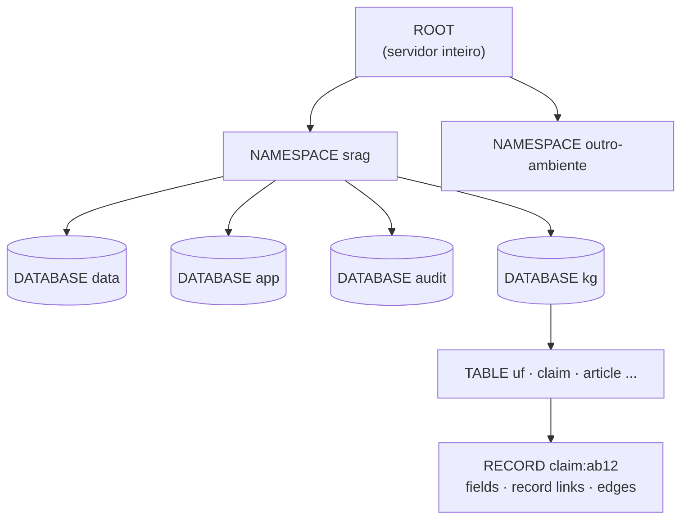

# SurrealDB: guia de recursos e de como o projeto o usa

Banco de dados **multi-modelo** (documento, grafo, relacional, busca textual, vetorial, séries temporais e geoespacial) com uma linguagem de consulta própria, o **SurrealQL**. Este guia explica os conceitos (em especial **namespaces e databases**), os recursos relevantes e como o SRAG Sentinel os usa. Versão usada no projeto: **v4.0.1**, SDK Python 3.0.0 em modo servidor remoto (WebSocket).

> Fonte principal: a [documentação oficial](https://surrealdb.com/docs/what-is-surrealdb). Os links da seção 9 foram abertos e conferidos em 2026-11-17; recursos novos da v4 podem ter nomes ou sintaxes diferentes, então confirme na documentação antes de depender de um detalhe.

## 1. A ideia central

Todos os modelos de dados compartilham **um único armazenamento chave-valor**; o que muda é como as chaves são organizadas e consultadas. Por isso um mesmo banco guarda documentos, arestas de grafo, índices de texto e vetores, e uma mesma consulta pode misturá-los. No SRAG Sentinel isso evita operar dois sistemas (relacional + grafo) ([ADR 0003](adr/0003-surrealdb-single-store.md), [ADR 0016](adr/0016-graphrag-on-surrealdb.md)).

## 2. Como funcionam os "Databases" (hierarquia)



| Nível | O que é | Contém | Quem administra |
|---|---|---|---|
| **Root** | o servidor | todos os namespaces | usuário root (definido na inicialização) |
| **Namespace** | contêiner mais externo, para isolar uma organização, equipe, aplicação ou **ambiente** | apenas databases (e seus próprios usuários) | usuários de root ou do namespace |
| **Database** | onde ficam os dados | tabelas, campos, índices, eventos, funções, parâmetros e métodos de acesso | usuários de root, do namespace ou do database |
| **Tabela** | coleção de registros | registros (documentos) | definida com `DEFINE TABLE` ou criada implicitamente |
| **Registro** | uma linha/documento, com ID `tabela:id` | campos tipados, links e arestas | — |

Pontos que costumam confundir:

- **Uma conexão fala com um namespace e um database por vez.** Selecione com `USE NS srag DB kg` (ou `connection.use(ns, db)` no SDK). Não há consulta que junte dois databases: para cruzar dados, a aplicação lê de cada um.
- **O database é a fronteira de isolamento e de permissão.** Usuários, índices, funções e esquemas pertencem a um database (ou a um nível acima). Um usuário de database só enxerga aquele database e precisa informar namespace e database para entrar.
- **Namespaces isolam ambientes.** Os testes de integração do projeto criam um namespace descartável por teste (`it_<hash>`) e o removem ao final, sem tocar em mais nada.
- **Criar e inspecionar:** `DEFINE NAMESPACE`, `DEFINE DATABASE`, `INFO FOR ROOT`, `INFO FOR NS`, `INFO FOR DB`. Em v4, `DEFINE DATABASE` aceita `IF NOT EXISTS`, `OVERWRITE`, `STRICT` (proíbe usar tabelas não definidas), `COMPATIBILITY` e `COMMENT`.
- **Por padrão, `CREATE` em uma tabela inexistente a cria** (modo flexível). Para o contrário, use `STRICT` no database.

### Como o projeto usa os databases

Um namespace (`srag`) com **quatro databases**, cada um com usuários de privilégio mínimo ([ADR 0003](adr/0003-surrealdb-single-store.md)):

| Database | Conteúdo | Usuários | Esquema |
|---|---|---|---|
| `data` | contadores diários por UF (`srag_daily`), manifestos de ingestão | `ingest` (EDITOR, só a ingestão), `api_ro` (VIEWER, a API) | [`db/schema/data.surql`](../src/srag_sentinel/db/schema/data.surql) |
| `audit` | cadeia de hashes da auditoria | escritor por **record access** (cria e lê, não altera nem apaga), `audit_reader` (VIEWER) | [`db/schema/audit.surql`](../src/srag_sentinel/db/schema/audit.surql) |
| `kg` | grafo de conhecimento (UFs, patógenos, artigos, afirmações, arestas) | `kg_writer` (EDITOR), `api_ro` (VIEWER) | [`kg/schema/kg.surql`](../src/srag_sentinel/kg/schema/kg.surql) |
| `app` | reservado (hoje os relatórios ficam em arquivos) | `api_rw` (EDITOR) | [`db/schema/app.surql`](../src/srag_sentinel/db/schema/app.surql) |

`srag-sentinel db init` cria tudo de forma **idempotente** (namespace, databases, esquemas, usuários e as sementes do grafo). O usuário root só é usado nesse bootstrap; a aplicação nunca usa root.

## 3. O que existe dentro de um database

| Recurso | Para quê | Exemplo |
|---|---|---|
| **Tabelas** | `SCHEMAFULL` (campos declarados, o resto é recusado) ou `SCHEMALESS` | `DEFINE TABLE claim SCHEMAFULL;` |
| **Campos** | tipo, `ASSERT`, `DEFAULT`, `READONLY`, `PERMISSIONS`, `FLEXIBLE` (objetos com chaves livres) | `DEFINE FIELD confidence ON claim TYPE float ASSERT $value >= 0;` |
| **Tabelas de relação** | arestas de grafo tipadas | `DEFINE TABLE mentions TYPE RELATION IN article OUT uf ENFORCED;` |
| **Índices** | `UNIQUE`, `FULLTEXT` (analisador + BM25), `HNSW` (vetores) | `DEFINE INDEX article_text ON article FIELDS text FULLTEXT ANALYZER pt_br BM25;` |
| **Analisadores** | tokenização e filtros de texto | `DEFINE ANALYZER pt_br TOKENIZERS class FILTERS lowercase, ascii, snowball(portuguese);` |
| **Eventos** | gatilhos após alterações | `DEFINE EVENT ... ON TABLE ... WHEN ... THEN ...` |
| **Funções e parâmetros** | lógica reutilizável no banco | `DEFINE FUNCTION fn::nome(...)`, `DEFINE PARAM` |
| **Métodos de acesso** | login de usuários da aplicação (`RECORD`) e tokens (`JWT`) | `DEFINE ACCESS audit_writer ON DATABASE TYPE RECORD ...` |
| **Changefeeds** | fluxo de alterações para integração | opção em `DEFINE TABLE`/`DATABASE` |
| **Live queries** | notificações em tempo real | `LIVE SELECT * FROM claim;` |

## 4. Modelos de dados

| Modelo | Como se faz | No projeto |
|---|---|---|
| **Documento** | registros com objetos e arrays aninhados | todas as tabelas |
| **Grafo** | `RELATE a->aresta->b` e travessia com `->` e `<-`; arestas são registros com campos próprios | fronteiras entre UFs, `article -mentions-> uf`, `claim -concerns-> pathogen`, caminho de cada evidência ([ADR 0017](adr/0017-knowledge-graph-model.md)) |
| **Relacional** | links entre registros (`record<tabela>`), `FETCH`, junções por links | `uf.region`, `snapshot` |
| **Busca textual** | `DEFINE ANALYZER` + índice `FULLTEXT` + operador de busca e `search::score()` | busca de artigos e afirmações em pt-BR |
| **Vetorial** | campos de vetores + índice `HNSW` + KNN | **não implementado** (opcional, [ADR 0016](adr/0016-graphrag-on-surrealdb.md)) |
| **Séries temporais** | IDs ordenados (ex.: `tabela:[uf, data]`) e varreduras por intervalo | `srag_daily:[uf, dia]` |
| **Geoespacial** | tipos e funções geográficas | não usado |

Exemplos reais do projeto:

```surql
-- travessia de 2 saltos: UFs vizinhas das vizinhas de SP
SELECT VALUE ->adjacent_to->uf->adjacent_to->uf.code FROM uf:SP;

-- busca textual com pontuação BM25, em pt-BR (acentos e plural funcionam)
SELECT id, search::score(1) AS score FROM article WHERE text @1@ $q ORDER BY score DESC;

-- escrita idempotente de aresta (RELATE simples duplicaria a cada execução)
INSERT RELATION INTO adjacent_to { id: adjacent_to:SP_RJ, in: uf:SP, out: uf:RJ }
  ON DUPLICATE KEY UPDATE produced_by = 'seed';
```

## 5. SurrealQL em resumo

- **Instruções:** `SELECT`, `CREATE`, `UPDATE`, `UPSERT`, `INSERT` (incl. `INSERT RELATION` e `ON DUPLICATE KEY UPDATE`), `DELETE`, `RELATE`, `LIVE SELECT`, `DEFINE`/`REMOVE`/`INFO FOR`, `USE`.
- **IDs compostos e por função:** `type::record('uf', $codigo)` monta o ID a partir de uma variável (sem concatenar texto).
- **Variáveis ligadas (`$nome`)** são o jeito seguro de passar valores; **nunca** formate dados de usuário dentro da consulta. Identificadores (nomes de tabela) só podem vir de listas fechadas no código.
- **Transações:** `BEGIN` / `COMMIT` / `CANCEL`, com isolamento serializável.
- **Funções embutidas** por categoria: `time::`, `array::`, `string::`, `math::`, `crypto::` (ex.: `crypto::argon2::generate`), `search::`, `vector::`, `geo::`, `type::`.
- **Subconsultas, projeções, agregações (`GROUP`), `FETCH` e travessias** podem ser combinadas na mesma instrução.

## 6. Segurança: usuários, papéis e permissões

| Conceito | Detalhe |
|---|---|
| **Usuários de sistema** | `DEFINE USER` em **root, namespace ou database**; o alcance segue o nível onde foi criado |
| **Papéis** | `OWNER` (administra), `EDITOR` (altera dados), `VIEWER` (só lê) |
| **Usuários de registro** | `DEFINE ACCESS ... TYPE RECORD` com `SIGNUP`/`SIGNIN`; vivem como registros comuns, não têm papéis e começam **sem permissão** |
| **`PERMISSIONS`** | por tabela e por campo; padrão `NONE` para usuários de registro; `$auth` identifica quem está logado |
| **Campos `READONLY`** | não podem ser alterados depois de gravados |

Lições aprendidas neste projeto (detalhes em [ADR 0013](adr/0013-surrealdb-findings.md) e [ADR 0019](adr/0019-surrealdb-kg-findings.md)):

- **Negação de permissão devolve resultado vazio, não erro.** Toda escrita crítica é conferida depois de feita.
- **`EDITOR` e root ainda conseguem apagar.** Por isso a trilha de auditoria usa um usuário de *record access* que não tem esse poder, e a aplicação nunca recebe credenciais de administrador.
- **`PERMISSIONS` de tabela valeram também para o `VIEWER`** (com `FOR create FULL`, um `VIEWER` conseguiu criar registros), enquanto `EDITOR` e root as **contornam**. A correção foi `FOR create WHERE $access = 'audit_writer'`, que só o usuário de record access satisfaz. Esse comportamento foi observado na v4.0.1 e difere do que a documentação sugere; confirme em testes antes de confiar.
- **`$auth` e `$session` vieram vazios** nas sessões de teste: a lógica de permissão usa `$access`.
- **Campos `READONLY` valem até para root**, o que torna a cadeia de hashes inalterável pelo esquema.
- **Valores só como variáveis ligadas.** `DEFINE USER ... PASSWORD` não aceita variável; por isso há um escape de literais restrito ([`db/client.py`](../src/srag_sentinel/db/client.py)).

## 7. Armazenamento, implantação e ferramentas

- **Execução:** servidor (`surreal start`), embutido em aplicações e no navegador (WASM) e modos distribuídos. O projeto usa **servidor remoto por WebSocket** em um contêiner, com dados em volume ([`compose.yaml`](../compose.yaml)). O comando `surreal start --bind 0.0.0.0:8000 rocksdb:/data/srag.db` define o endereço e o motor de armazenamento (a documentação lista memória, RocksDB, SurrealKV e armazenamentos distribuídos).
- **CLI:** `surreal start`, `surreal sql` (shell interativo), `surreal import`/`export`, `surreal isready` (usado no healthcheck).
- **SDKs:** JavaScript, Python, Rust, Go, Java, .NET, PHP e outros. O projeto usa o SDK Python assíncrono ([`db/client.py`](../src/srag_sentinel/db/client.py)).
- **Surrealist:** interface gráfica oficial para consultar e visualizar esquemas e grafos.
- **Skills no repositório** (para assistentes de código): [`.claude/skills/`](../.claude/skills/README.md) traz `surrealql`, `surrealql-functions`, `surrealql-performance`, `surrealdb-python`, `surrealdb-cli`, `surrealdb-vector` e as convenções do projeto (`srag-surrealdb-conventions`, `srag-graphrag-kg`).

## 8. Armadilhas conhecidas (v4.0.1, verificadas aqui)

| Situação | O que acontece |
|---|---|
| `FULLTEXT` com `FIELDS a, b` | erro: o índice cobre **uma** coluna; junte os textos em um campo |
| `... ENFORCED SCHEMAFULL` | `ENFORCED` vem **antes** de `SCHEMAFULL` |
| `DEFINE FIELD` em várias tabelas | não aceita lista de tabelas: um por tabela |
| Busca com vários termos | exige **todos** os termos (AND); para OR, uma consulta por termo |
| Stemmer `snowball(portuguese)` | não unifica `internação`/`internações`, `vacina`/`vacinação`: expanda os termos |
| `RELATE` repetido | cria uma nova aresta; use `INSERT RELATION ... ON DUPLICATE KEY UPDATE` com ID determinístico |
| Objeto aninhado em tabela `SCHEMAFULL` | exige `FLEXIBLE` no campo, senão a chave interna é recusada |
| `count() ... GROUP ALL` em tabela vazia | devolve `[{count: 0}]`, não lista vazia |

## 9. Referências

### Documentação oficial (links conferidos)
- [O que é o SurrealDB](https://surrealdb.com/docs/what-is-surrealdb) · [Conceitos](https://surrealdb.com/docs/surrealdb/introduction/concepts) (namespace, database, tabela, registro, ID)
- [Modelos de dados](https://surrealdb.com/docs/surrealdb/models): [grafo](https://surrealdb.com/docs/surrealdb/models/graph) · [busca textual](https://surrealdb.com/docs/surrealdb/models/full-text-search) · [vetorial](https://surrealdb.com/docs/surrealdb/models/vector)
- [SurrealQL](https://surrealdb.com/docs/surrealql) · [`DEFINE DATABASE`](https://surrealdb.com/docs/surrealql/statements/define/database) · [`DEFINE ACCESS`](https://surrealdb.com/docs/surrealql/statements/define/access) · [`RELATE`](https://surrealdb.com/docs/surrealql/statements/relate) · [`LIVE SELECT`](https://surrealdb.com/docs/surrealql/statements/live)
- [Autenticação, usuários e papéis](https://surrealdb.com/docs/surrealdb/security/authentication)
- [`surreal start`](https://surrealdb.com/docs/surrealdb/cli/start) · [SDK Python](https://surrealdb.com/docs/sdk/python)
- Código-fonte: [github.com/surrealdb/surrealdb](https://github.com/surrealdb/surrealdb)

### Material de estudo
- [Learn: trilha de cursos](https://surrealdb.com/learn) · [Um tour do SurrealDB](https://surrealdb.com/learn/tour) · [Fundamentos](https://surrealdb.com/learn/fundamentals)
- [Aeon's Surreal Renaissance (livro)](https://surrealdb.com/learn/book) · [Aprendendo na prática: banco de filmes](https://surrealdb.com/learn/movies)
- [Esquemas e migrações](https://surrealdb.com/learn/schemas) · [SurrealDB para engenharia de IA](https://surrealdb.com/learn/ai)
- [Canal no YouTube](https://www.youtube.com/@surrealdb) · [Blog no Medium](https://medium.com/surrealdb) · [dev.to](https://dev.to/surrealdb)

### Comunidade
- [Discord](https://discord.gg/surrealdb) · [Reddit r/surrealdb](https://www.reddit.com/r/surrealdb)

### Neste repositório
[ADR 0003](adr/0003-surrealdb-single-store.md) (banco único) · [ADR 0013](adr/0013-surrealdb-findings.md) (papéis e auditoria) · [ADR 0016](adr/0016-graphrag-on-surrealdb.md) (GraphRAG) · [ADR 0017](adr/0017-knowledge-graph-model.md) (modelo do grafo) · [ADR 0019](adr/0019-surrealdb-kg-findings.md) (achados do grafo) · [spec 07](specs/07-graphrag-knowledge-graph.md) · [spikes](../spikes/) · [testes de integração](../tests/integration/)
